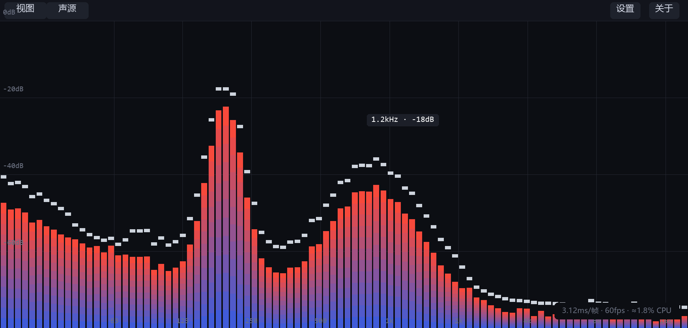
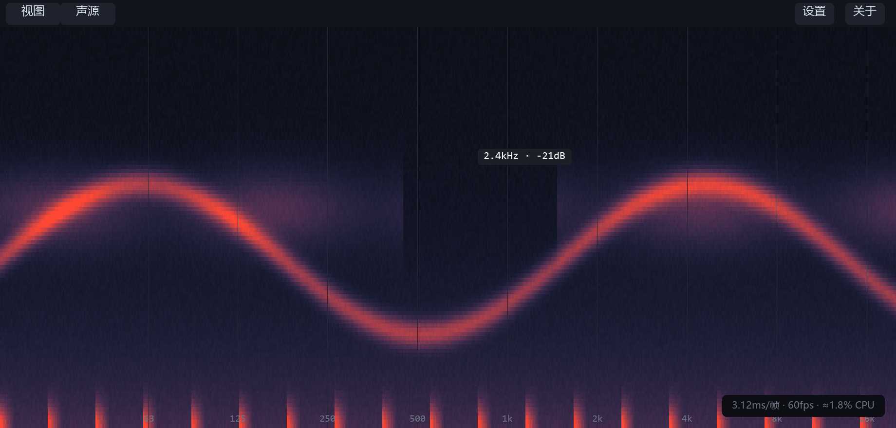

# audio-spectrum

把系统正在播放的声音变成频谱的跨平台(Windows / macOS / Linux)桌面小应用:
回环(Loopback)或麦克风采集 → 2048 点实 FFT → 对数轴(20Hz–20kHz)频段聚合
→ 60fps 渐变柱频谱与 12s 滚动语谱。陪伴式设计:全出血无边框、置顶、全屏、
主题配色与背景图均可调。





> 界面示意图:按真实布局/配色常量由 `scripts/gen-screenshots.py` 生成,
> 音频内容为模拟数据。

**主要特性**

- **实时频谱**:对数轴 20Hz–20kHz,频段数 1–255 滑杆连续可调,快攻慢放
  平滑 + Peak Hold 峰值帽,衰减速度五档
- **语谱图**:12s 滚动历史、20ms 列聚合,`S` 键与频谱视图即切
- **声源**:系统回环(Windows WASAPI / macOS ScreenCaptureKit /
  Linux PulseAudio)或麦克风/线路输入,断线自动重连
- **个性化**:5 主题预设 + 逐槽颜色覆盖、背景图(填满/适应/平铺、
  不透明度、模糊)、窗口置顶/记忆/启动全屏
- **关于与更新**:应用内检查新版本、下载(实时进度条)、完成后自动
  换装重启,无需手动重装

领域术语见 [GLOSSARY.md](GLOSSARY.md),架构决策见 [docs/adr/](docs/adr/)。

## 运行

```bash
cargo run -p audio-spectrum-app   # macOS 首次运行会请求麦克风权限
# 快捷键:S = 循环切换视图(频谱→语谱→波形→粒子→光效→CD→静态→屏保),
#   Space = 冻结/解冻,⌘, = 特效窗体,
#   F11 = 全屏(仅 Windows/Linux;macOS 用 ⌘F),双击 = 全屏⇄窗口,ESC 关窗/退全屏
# 配置入口:特效窗体(菜单栏「特效」/【视图】菜单「特效…」/⌘,);
#   macOS「关于 audio-spectrum…」在原生应用菜单;设置存于
#   macOS ~/Library/Application Support/audio-spectrum/settings.ron
#   Windows %APPDATA%\audio-spectrum\settings.ron · Linux ~/.config/audio-spectrum/
scripts/bundle-macos.sh       # 打包 .app(Dock/启动台图标 + Info.plist + 麦克风用途声明)
open target/release/audio-spectrum.app
cargo test                    # core 管线 9 个行为测试 + 性能预算断言 + SCK 实机集成
cargo clippy --workspace --all-targets
```

窗口图标(标题栏/任务栏)由 256px PNG 经 `include_bytes!` 编进二进制;
Windows 程序文件图标(资源管理器)经 `build.rs` + `winresource` 嵌入
多尺寸 `assets/icons/audio-spectrum.ico`(16–256px,构建期自动编译,
同时写入 FileDescription/ProductVersion 元数据);macOS Dock/启动台
图标由 bundle 脚本装配(`assets/audio-spectrum.icns`);Linux 捆包
含 freedesktop 集成(桌面入口 + hicolor 图标 + `install.sh`,装入
`~/.local`,ELF 无资源段,图标经 desktop 文件生效)。
Windows/Linux 构建说明:Linux 需系统音频开发库 `libasound2-dev`(+ `pkg-config`);
Windows 交叉检查可用 `rustup target add x86_64-pc-windows-msvc` +
`cargo check --target x86_64-pc-windows-msvc -p audio-spectrum-capture`。

## 架构

```
crates/
├── core      纯函数频谱管线：samples → FFT(2048/realfft/Hann)→ Bin → Band 聚合
│             (对数轴 20Hz–20kHz，取 max + 低频插值)→ dBFS；Smoother(快攻慢放
│             + Peak Hold)。无 I/O、无 FFI，全部行为测试覆盖。
├── capture   CaptureBackend：cpal 输入采集(三平台)+ 音频线程回调(只写环缓冲，
│             ADR-0002)→ 归一化(f32 / 48kHz / 单声道)→ ringbuf SPSC。
└── app       iced 壳(Elm 架构):声源选择、断线自动 Reconnect、八视图画布
             (频谱/语谱/波形/粒子/光效/CD/静态/屏保,共享 Bass Level 律动)、
             特效窗体(9 tab 归拢全部视图配置,ADR-0005)、常驻 60fps 重绘
             (画布在每次重绘请求时发布 Frame 消息,自维持 vsync 帧循环)。
```

线程模型(ADR-0002):音频回调只写环缓冲,不分配不加锁;FFT 在 UI 线程每帧执行
(2048 点实 FFT 微秒级)。窗口在后台时音频继续写入,溢出丢弃(仅影响显示)。

## 状态

- ✅ v0.8.0 八视图 + 特效窗体:视图泛化为有序清单(频谱 → 语谱 → 波形 →
  粒子 → 光效 → CD → 静态 → 屏保),S 键循环全部、菜单/tab 同源联动;
  新增四个音乐响应 Effect(波形吃原始样本帧,粒子/光效/CD 由 core 新
  共享 Bass Level 同步律动)与两个非响应视图(静态 = 通用背景图独占,
  屏保 = 不监听音源的六风格动画:变幻线/彩带/极光/管道/气泡/飞越星空);
  【视图】菜单加「特效…」入口,特效窗体 9 tab(八视图 + 通用)归拢
  全部视图配置:频段数/衰减速度/Peak Hold/网格/样式 移入频谱 tab,
  设置窗取消(背景图进「通用」页),术语与决策见 GLOSSARY.md
  Views and Effects 节与 docs/adr/0005
- ✅ v0.7.0 关于/检测更新双窗口 + 应用内更新:菜单栏末尾「关于」下拉含
  「关于」「检测更新」两个子项(macOS 为原生菜单「关于 audio-spectrum /
  检测更新…」),各自打开独立窗口——关于窗:程序图标、名称-版本号
  纵向水平居中,下方开源地址与程序说明;检测更新窗:启动时自动检测,
  有新版时菜单「关于」右上角显示红点,窗内显示「当前版本 → 最新
  版本」+「更新」按钮 → 下载(实时进度条)→ 完成即自动换装重启
  (零确认);更新源为 GitHub Releases(资产命名对齐 CI 三平台产物),
  版本号按 semver 比较(同版本重建不提示);换装采用「旧版改名 .old
  让位 → 新版就位 → 拉起新进程」(macOS .app 整包替换),启动时自动
  清理残留,失败回滚并可重试。术语与决策见 GLOSSARY.md Updater 节与
  docs/adr/0004
- ✅ v0.6.0 应用菜单栏 + Windows Loopback 修复:非 macOS 取消右键菜单,
  改为窗口顶部常驻应用菜单栏;视图菜单聚合视图/全屏/窗口(启动全屏、
  置顶、记忆)/频段数(1–255 滑杆连续可调)/衰减速度(极慢—极快五档),
  设置窗只剩 Peak Hold、网格、样式、背景图;左下状态浮层移除;绘图区
  全出血铺满窗体(频率刻度内嵌底缘);双击主体内容切换全屏;修复背景图
  遮挡频谱/语谱(iced canvas 同帧内图像
  恒绘制在几何之上:背景图/语谱纹理拆为独立 canvas widget 层,经
  stack 分层叠放,频谱主体在最上);Windows 后端修复两处导致 Loopback 永远不可用的缺陷
  (枚举器 CLSID 写错 → REGDB_E_CLASSNOTREG;流启动后无就绪回报 →
  打开必然超时)
- ✅ v0.4.0 原生菜单与全幅画布:macOS 原生菜单栏(AppKit NSMenu:应用
  菜单/视图/动态声源,⌘, 设置);顶栏移除,频谱铺满窗体,状态降为
  左下浮层(HUD 右下,默认关);设置改为独立滚动窗口
- ✅ v0.3.0 个性化中枢:设置持久化(ron,`dirs` 平台惯例目录,300ms 防抖,
  损坏静默回默认)——样式主题(5 预设 + 逐槽颜色覆盖/圆角/间隙/网格)、
  背景图(选择/缩放 填满·适应·平铺/不透明度/预烘焙模糊)、窗口(默认
  全屏、尺寸位置记忆);频谱占满窗体,配置全部收进 ⚙ 菜单;全屏时
  顶栏自动隐藏(贴顶 8px 浮现),ESC/右键退全屏
- ✅ v0.2.0 功能纵深(陪伴式视觉化,ADR-0003):

  - **语谱图**(Spectrogram):12s 滚动历史、20ms 列聚合(窗口最大值)、
    复用 96 Band 对数轴、纹理单 quad 渲染;`S` 键或顶栏按钮切换
  - **检视交互**:悬停显示 `频率 · dB`(光标跟随);`Space` 冻结画面
  - **极简三件套设置**:频段数 64/96、Peak Hold 开关、衰减速度(慢/中/快)
  - **窗口置顶** toggle(陪伴场景钉在角落)
- ✅ 输入采集(麦克风/线路输入):三平台,含设备选择与断线重连
- ✅ Loopback(系统回环):三平台后端已实现

  - macOS:ScreenCaptureKit,实机验证(集成测试:`cargo test -p audio-spectrum-capture`)
  - Windows:WASAPI loopback,交叉编译验证(x86_64-pc-windows-msvc,待实机)
  - Linux:PulseAudio monitor(PipeWire 经兼容层),源码级验证(待 Linux 机器编译)
- ✅ 频谱管线 + 平滑 + Peak Hold + 语谱历史 + 设置中枢:22 个测试全绿,clippy 零警告
- ✅ 性能预算:已仪表化

  - 自动断言:`cargo test -p audio-spectrum-core --test perf`(实测 release 25.6µs/帧,
    帧预算 16.7ms 的 0.15%,验证 ADR-0002 的微秒级假设)
  - 运行时 HUD:顶栏实时显示「ms/帧 · fps · ≈% CPU」(帧耗时 EMA ≈ 60 帧)
  - 端到端延迟 < 50ms:受采集后端影响,需实机人工验收(轮询后端 10ms 周期)

## CI / 下载

GitHub Actions(`.github/workflows/build.yml`)三平台构建:

- **触发方式**:推送 `v*` 格式的 tag,构建完成后自动在该 tag 上创建正式
  Release 并上传三平台产物;发布可直接用 `cargo run -p xtask -- release [版本号]`
  (版本号缺省取自根 `Cargo.toml` 的 workspace 版本,自动校验工作区干净
  与 tag 不重复,并把当前分支与新 tag 一并推送)
- **矩阵**:macOS arm64(`.app` zip)、Windows x64(zip)、Linux x64(tar.gz),
  含 `cargo test` 与性能预算断言(CI 无音频硬件时自动跳过 SCK 实机集成测试)
- **产物命名**:`audio-spectrum-v<版本>-<UTC日期>-<平台>.zip/tar.gz`
  (版本号取自 `Cargo.toml`,日期标签由 prepare 作业统一生成)
- **应用内更新**:已安装的客户端在「关于」菜单可一键检查/下载/换装
  (资产命名与平台匹配规则见 `crates/app/src/updater.rs`)
- 首次接入:
  ```bash
  git remote add origin git@github.com:<你>/audio-spectrum.git
  git push -u origin main
  ```

## 已知取舍

- Windows 上 wgpu 后端钉到 DX12(`pin_windows_wgpu_backend`,用户设置的
  `WGPU_BACKEND` 优先):AMD + 虚拟显示驱动环境下,Vulkan 交换链在切全屏时
  返回 SurfaceError,iced 0.14 的 present 不容忍即 panic(DX12/GL 实测健康)。
- 启动全屏不在创建窗口时应用,首帧后经 window::set_mode 进入(避免部分
  驱动下创建即全屏的交换链异常,切换瞬间可能闪一下窗口模式)。
  两项决策的完整诊断见 docs/adr/0006。
- iced canvas 无自定义 shader:光效律动用分层半透明圆叠加模拟辉光;
  CD 整盘旋转靠 draw_image 的变换烘焙,圆形封面在加载时烘焙圆形 alpha
  蒙版(canvas 无路径裁剪);屏保六风格内置固定构图,无参数可调。
- 应用内更新:
  - 依赖 GitHub Releases 资产命名约定(`audio-spectrum-<标签>-<平台>.zip/tar.gz`,
    与 CI 产物一致);平台仅覆盖 CI 矩阵(Windows x64 / macOS arm64 / Linux x64),
    其余平台报「暂不支持」。
  - 版本比较只取 semver(资产名里的 `x.y.z`),CI 时间戳标签仅作展示:
    同版本重建不会提示更新。
  - 换装需要写权限:新版下载/解压在可执行文件同目录 `.update-tmp`,
    目录不可写(如受控的 `/Applications`)时会失败并提示;
    macOS 以 `open` 拉起新包,裸二进制( cargo run )直接 spawn。
  - 检查走未鉴权 GitHub API(60 次/时/IP):启动自动检测一次 + 手动
    检查,足够使用;检测线程异常退出时状态机回 Idle,可重新发起。
  - 下载产物不做 SHA256 校验:HTTPS 传输完整性对当前威胁模型足够;
    若要加,CI 需先发布 .sha256 摘要。
- 设备身份:macOS 用 SCK 伪设备“系统音频输出”;Windows 用 WASAPI 端点 ID;
  Linux 用 PulseAudio monitor source 名;设备列表每秒轮询刷新。
- macOS 26 拖动标题栏时起始瞬间卡顿(循环运行时明显,暂停后无;与单帧
  成本无关):winit 0.30 macOS 刻意只在 Default 运行循环模式派发事件与
  重绘,拖动起始切入 EventTracking 模式后帧循环被停住,直到第一个
  `windowDidMove` 经委托路径同步泵起恢复。应用层无解,升级 winit/iced
  或向上游报 issue(最小复现:repro/drag-stutter)。
- macOS 26 的 SCStreamConfiguration 已无 `capturesCurrentAudioOutput`(13–15 的
  API),实现改用 display 范围 filter + `capturesAudio`(详见
  `crates/capture/src/macos.rs` 注释)。
- CoreMedia 的 AudioBufferList 提取要求两段式精确尺寸查询(SCK 怪癖),
  同样记录在 macos.rs 注释里。
- WASAPI/PulseAudio 后端在专用线程上 10ms 轮询取包(与 SCK 回调等价的
  “只写环缓冲”不变量);COM/Pulse 锁均隔离在采集线程内。
- Smoother 系数按 60fps 标定，高刷新率屏幕上衰减会略快(纯视觉，可接受)。
- 文本渲染用 iced/cosmic-text 的系统字体库：主字体指平台 CJK 家族
  (微软雅黑/PingFang/Noto CJK)并注册候选字体字节作字形回退后备，找不到时
  逐字形回退，中文不会变方框(与旧 egui 壳手装字体的行为等价)。
- iced 壳的已知取舍(相对旧 egui 壳)：
  - 设置窗的颜色覆盖用「色板 + 十六进制输入 + ↺ 重置」代替原生取色器；
  - 非 macOS 应用菜单栏为扁平下拉(无子菜单,声源直接列出);
  - 全屏状态经 250ms 节流回读 `window::mode` 同步(兼容系统绿色按钮)，
    绿色按钮进入全屏的勾选态可能滞后至多 250ms；
  - 键盘快捷键只在无文本输入框抢占键盘时生效(输入十六进制色值时 S/Space
    照常输入，不触发切换；iced 0.14 的按钮不接键盘焦点，点击按钮后
    快捷键不受影响)。
